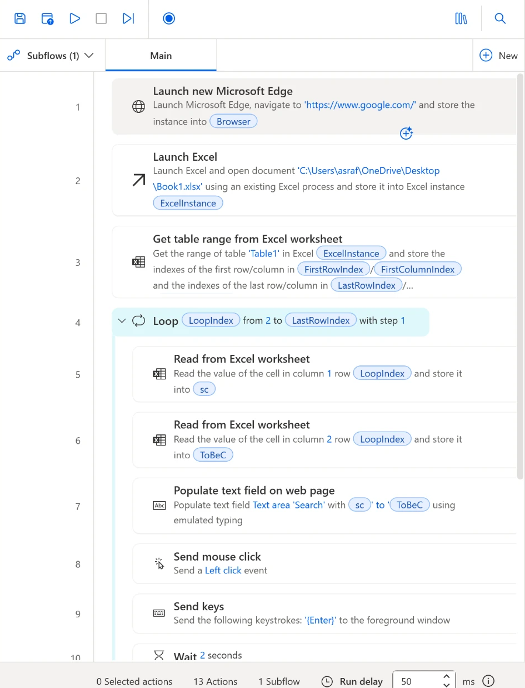
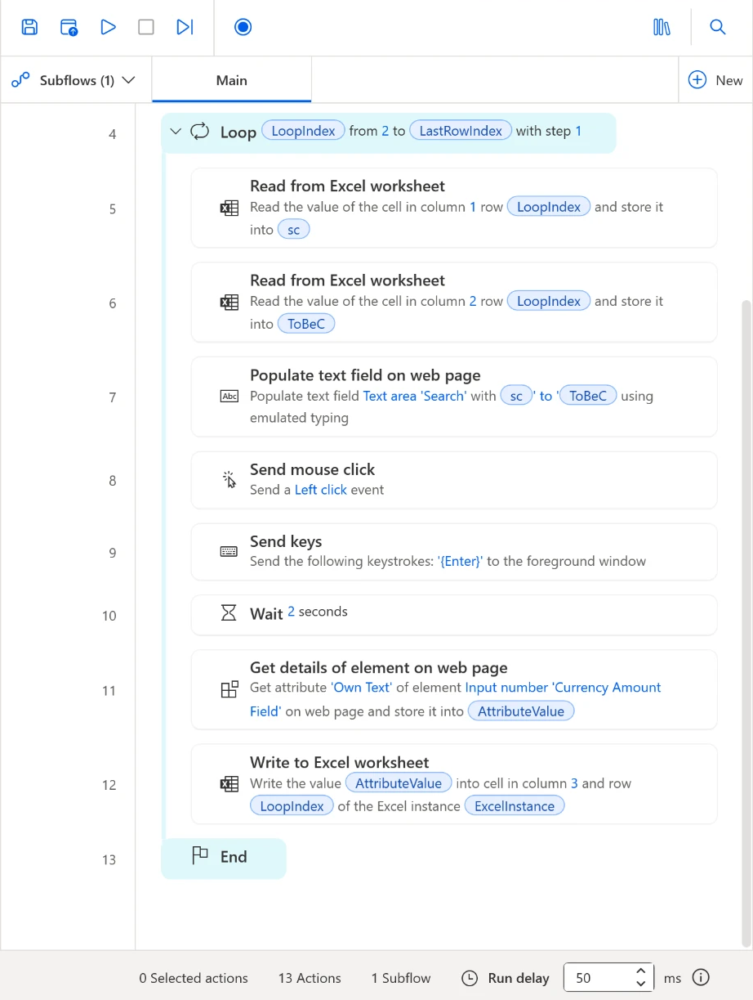

# 11 - Look Up Currency Rates with a Desktop Flow

Every chapter so far built a cloud flow that talks to online services. This one is different. You build a **desktop flow** in Power Automate for desktop that drives your own computer: it opens Excel and Microsoft Edge, searches Google for each currency pair in a list, reads the converted amount off the page and types it back into Excel.

> **Copy-paste values:** every value you need is in the steps, with a Copy button. The [copy-paste page](./copy-paste.md) has them all on one page too.

**Estimated time:** 45 minutes

**Your result:** A desktop flow that loops through a list of currency pairs in Excel, looks up each rate on Google in Edge and writes the result into the third column.

**Files for this lab:**

- [CurrencyList.xlsx](https://asraf-js.github.io/Microsoft-Power-Automate/11-desktop-currency-lookup/CurrencyList.xlsx): the list of currency pairs. Save it to your **Desktop**.

---

## What You Will Learn

- Create a desktop flow in Power Automate for desktop
- Open Edge and Excel from a flow and store each one in a variable
- Find where an Excel table starts and ends with **Get table range from Excel worksheet**
- Repeat steps for every row with a **Loop**
- Capture UI elements on a web page and fill in or read them
- Send mouse clicks and keystrokes the way a person would
- Write a value back into a cell

---

## How the Flow Works

**Launch Edge > Launch Excel > Get table range > Loop (read From and To > type the search > press Enter > wait > read the rate > write it to Excel) > End**

The flow opens Google in Edge and the workbook in Excel. It asks Excel where `Table1` ends, then loops from row 2 (the first row under the headings) to the last row. On each pass it reads the two currency codes, types something like `USD to MYR` into Google, reads the converted amount from Google's currency converter and writes it into column 3 of the same row.

| Cloud flow (Chapters 3 to 8) | Desktop flow (this chapter) |
|------------------------------|-----------------------------|
| Runs in Microsoft's cloud, even when your PC is off | Runs on your PC, using your mouse, keyboard and screen |
| Talks to services through connectors | Clicks, types and reads windows and web pages like a person |
| Built in a browser at make.powerautomate.com | Built in the Power Automate for desktop app |

> **Key point:** A desktop flow takes over your mouse and keyboard while it runs. Once you select Run, keep your hands off them until the flow finishes.

---

## Before You Begin

You need:

- A Windows computer with **Power Automate for desktop** installed, signed in with your training account. Search for *Power Automate* in the Start menu. If it isn't installed, ask your trainer.
- The **Excel desktop app**. This flow opens the file in Excel on your PC, not Excel for the web.
- **Microsoft Edge** with the **Microsoft Power Automate** browser extension turned on. In Power Automate for desktop, select **Tools** > **Browser extensions** > **Microsoft Edge** to install it, then turn it on in Edge's extensions page.
- `CurrencyList.xlsx` saved to your Desktop. Download it from the link at the top of this page.

The workbook has one table, named `Table1`:

| Column | Heading | Contents |
|--------|---------|----------|
| 1 | From | The currency you have, such as `USD` |
| 2 | To | The currency you want, such as `MYR` |
| 3 | Result | Empty. The flow fills it in |

> **Warning:** This flow reads a real web page that Google controls. If Google shows a cookie or sign-in prompt, accept or close it once in Edge before you run the flow. If Google changes its page, the UI elements you capture in 11.6 and 11.10 may stop matching and you'll need to capture them again.

---

## 11.1 Create the Desktop Flow

1. Open **Power Automate** from the Start menu. This is the desktop app, not the website.
2. Select **+ New flow**.
3. In **Flow name**, enter the name below, then select **Create**.

   ```text
   PA - Currency lookup
   ```

4. The flow designer opens. **Actions** is on the left, the **Main** tab (your flow) is in the middle, and the variables pane is on the right.

To add any action in this chapter: type its name in the **Search** box at the top of the Actions pane, then double-click it, or drag it into the Main tab where you want it. A settings window opens. Fill it in and select **Save**.

---

## 11.2 Open Google in Edge

1. Search for `Launch new Microsoft Edge` and add it.
2. Set **Launch mode** to **Launch new instance**.
3. In **Initial URL**, enter:

   ```text
   https://www.google.com/
   ```

4. Set **Window state** to **Maximized**, so Edge fills the screen.
5. Leave **Variables produced** as `Browser`. Later actions use it to know which Edge window to work in.
6. Select **Save**.

---

## 11.3 Open the Workbook in Excel

1. Search for `Launch Excel` and add it below the Edge action.
2. Set **Launch Excel** to **and open the following document**.
3. In **Document path**, select the file icon at the right of the box, browse to your Desktop and select `CurrencyList.xlsx`.
4. Leave **Make instance visible** on, so you can watch the results appear.
5. Leave **Variables produced** as `ExcelInstance`.
6. Select **Save**.

---

## 11.4 Find the End of the Table

You could tell the loop to stop at row 6, but then it breaks the day someone adds a seventh pair. This action asks Excel where the table ends instead.

1. Search for `Get table range from Excel worksheet` and add it below Launch Excel.
2. **Excel instance** already shows `%ExcelInstance%`. Leave it.
3. In **Table name**, enter:

   ```text
   Table1
   ```

4. Select **Save**. It produces four variables: `FirstRowIndex`, `FirstColumnIndex`, `LastRowIndex` and `LastColumnIndex`. You only need `LastRowIndex`, the row number of the last row in the table (6 in the downloaded file).

> **Note:** Power Automate for desktop writes variables between percent signs, like `%LastRowIndex%`. That tells it to use the variable's value instead of the text. You can type them, or select the **{x}** icon at the right of a box and pick one from the list.

---

## 11.5 Loop Through the Rows

1. Search for `Loop` and, under **Loops**, add **Loop** (not *For each* or *Loop condition*) below Get table range.
2. In **Start from**, enter `2`. Row 1 holds the headings, so the first pair is on row 2.
3. In **End to**, enter:

   ```text
   %LastRowIndex%
   ```

4. In **Increment by**, enter `1`.
5. Leave **Variables produced** as `LoopIndex`. It holds the current row number: 2 on the first pass, then 3, and so on.
6. Select **Save**. The designer adds a **Loop** line and an **End** line. Every action from 11.6 to 11.11 goes **between** them, so drop each one just above **End**. Actions inside the loop are indented.

---

## 11.6 Read the Two Currency Codes

**Read the From code (column 1)**

1. Search for `Read from Excel worksheet` and drag it between **Loop** and **End**.
2. Set **Retrieve** to **The value of a single cell**.
3. In **Start column**, enter `1`.
4. In **Start row**, enter:

   ```text
   %LoopIndex%
   ```

5. Under **Variables produced**, select the name `ExcelData` and change it to:

   ```text
   sc
   ```

   Short for *source currency*.
6. Select **Save**.

**Read the To code (column 2)**

1. Add another **Read from Excel worksheet** just below the first one, still inside the loop.
2. Set **Retrieve** to **The value of a single cell**, **Start column** to `2` and **Start row** to `%LoopIndex%`.
3. Rename the variable from `ExcelData` to:

   ```text
   ToBeC
   ```

   Short for *to be converted to*.
4. Select **Save**.

---

## 11.7 Type the Search into Google

You need Google open in Edge to capture its search box. Open Edge yourself, go to `https://www.google.com/` and leave it on screen.

1. Search for `Populate text field on web page` and add it below the second Read action, inside the loop.
2. **Web browser instance** shows `%Browser%`. Leave it.
3. Open the **UI element** dropdown and select **Add a new UI element**. The tracking window appears.
4. Switch to Edge and hover over Google's search box. When a red frame labelled **Text area 'Search'** surrounds the box, hold **Ctrl** and click.
5. Back in the action, **UI element** shows **Text area 'Search'**. In **Text**, enter:

   ```text
   %sc% to %ToBeC%
   ```

   For the first row this types `USD to MYR`.
6. Under **Advanced**, leave **Emulate typing** on, so the text is typed key by key like a person would.
7. Select **Save**.

---

## 11.8 Click and Press Enter

1. Search for `Send mouse click` and add it below the Populate action.
2. Leave **Mouse event to send** as **Left click** and **Move mouse** off. Select **Save**.

   This clicks wherever the mouse pointer is. Because Edge is maximized, that lands in Edge and makes sure Edge is the active window before the next step presses Enter.
3. Search for `Send keys` and add it below Send mouse click.
4. Leave **Send keys to** as **Foreground window**.
5. In **Text to send**, enter:

   ```text
   {Enter}
   ```

   Type it exactly, with curly brackets. You can also select **Special keys** under the box and pick **Enter**.
6. Select **Save**.

---

## 11.9 Wait for the Results

1. Search for `Wait` and, under **Flow control**, add **Wait** below Send keys.
2. In **Duration**, enter `2`. Select **Save**.

Google needs a moment to show the converter. Without the wait, the next action can look for the amount before it appears.

---

## 11.10 Read the Converted Amount

To capture the amount box, Google must be showing its converter. In Edge, search for `USD to MYR`. Google shows a currency converter with two amount boxes: the one you convert from and the converted amount.

1. Search for `Get details of element on web page` and add it below Wait.
2. **Web browser instance** shows `%Browser%`. Leave it.
3. Open **UI element**, select **Add a new UI element**, switch to Edge and hover over the **converted amount** box (the one showing the MYR value). When the red frame reads **Input number 'Currency Amount Field'**, hold **Ctrl** and click.
4. Set **Attribute name** to **Own Text**.
5. Leave **Variables produced** as `AttributeValue`.
6. Select **Save**.

> **Tip:** If the red frame grabs the whole converter instead of the box, move the pointer slightly further inside the box until the label reads *Input number*.

---

## 11.11 Write the Rate into Excel

1. Search for `Write to Excel worksheet` and add it below Get details, still inside the loop.
2. **Excel instance** shows `%ExcelInstance%`. Leave it.
3. In **Value to write**, enter:

   ```text
   %AttributeValue%
   ```

4. Set **Write mode** to **On specified cell**.
5. In **Column**, enter `3`. In **Row**, enter `%LoopIndex%`. The rate goes into the Result column of the same row the codes came from.
6. Select **Save**.

---

## 11.12 Check Your Finished Flow

Select **Save** (the disk icon at the top left). The status bar at the bottom should show **13 Actions**. Compare your flow with these two screenshots: the first shows the top, the second is scrolled down to the end of the loop.



*Actions 1 to 3 open Edge and Excel and find the end of the table. Everything from 5 onwards is indented, so it runs once per row. Your document path shows your own user name.*



*Actions 11 and 12 read the converted amount and write it to column 3 of the current row. End closes the loop.*

| # | Action | What it does |
|---|--------|--------------|
| 1 | Launch new Microsoft Edge | Opens Google, stores the window in `Browser` |
| 2 | Launch Excel | Opens CurrencyList.xlsx, stores it in `ExcelInstance` |
| 3 | Get table range from Excel worksheet | Finds the last row of `Table1` |
| 4 | Loop | Repeats for rows 2 to `LastRowIndex` |
| 5 | Read from Excel worksheet | Column 1 of this row into `sc` |
| 6 | Read from Excel worksheet | Column 2 of this row into `ToBeC` |
| 7 | Populate text field on web page | Types `USD to MYR` into Google |
| 8 | Send mouse click | Makes sure Edge is active |
| 9 | Send keys | Presses Enter to search |
| 10 | Wait | Gives Google 2 seconds |
| 11 | Get details of element on web page | Reads the converted amount into `AttributeValue` |
| 12 | Write to Excel worksheet | Writes it to column 3 of this row |
| 13 | End | Goes back to Loop for the next row |

---

## 11.13 Run and Check

1. Close the Edge window you opened yourself and close `CurrencyList.xlsx` if it's open. The flow opens fresh copies.
2. Select **Run** (the play icon) in the toolbar.
3. Take your hands off the mouse and keyboard. Edge opens Google, Excel opens the workbook, and the searches run one after another.
4. When the status bar shows **Status: Ready** again, switch to Excel. The **Result** column has a rate on every row.
5. Save the workbook in Excel. The flow writes the values but doesn't save the file.

> **Note:** Every rate comes from Google at the moment the flow runs, so your numbers won't match anyone else's exactly.

---

## Independent Practice

Add two rows to `Table1` in Excel, for example `MYR` to `THB` and `AUD` to `MYR`, save and close the workbook, and run the flow again. Before you run it, predict: do you need to change the Loop? Why not?

---

> **Going further: tidy up when the loop ends.** After **End** (outside the loop), add **Close Excel** with **Before closing Excel** set to **Save document**, then **Close web browser** with `%Browser%`. The flow now saves your results and leaves nothing open. Optional.

---

## Troubleshooting

| Symptom | What to check |
|---------|---------------|
| Edge opens but nothing is typed | The Power Automate extension isn't turned on in Edge. Check Edge's extensions page |
| *Failed to get the UI element* on Populate text field | Google showed a cookie or sign-in prompt, or the search box changed. Clear the prompt, or capture the search box again in 11.7 |
| The search text appears but no search happens | The mouse click landed outside Edge, so Enter went to another window. Check Edge is set to Maximized, and don't move the mouse during the run |
| The Result column is empty or wrong | Capture the converted amount box again in 11.10, with Google's converter on screen. Increase Wait to `3` on a slow connection |
| Only the first row is filled | Every action from Read to Write must sit between Loop and End, indented. Drag any stray action back inside |
| *Table not found* | The table in the workbook must be named exactly `Table1`. Check **Table Design** > **Table Name** in Excel |
| The rate goes into the wrong row | Start row in both Read actions and Row in Write must all be `%LoopIndex%` |

---

## Lesson Summary

A desktop flow works your PC the way you would: it opened Excel and Edge, typed a search, pressed Enter, read a number off a web page and wrote it back into a cell. The Loop and `LoopIndex` kept every read and write on the same row, and Get table range meant the flow handles a longer list without changes.

For reference, see [Power Automate for desktop documentation](https://learn.microsoft.com/en-us/power-automate/desktop-flows/introduction), the [Excel actions reference](https://learn.microsoft.com/en-us/power-automate/desktop-flows/actions-reference/excel) and the [browser automation actions reference](https://learn.microsoft.com/en-us/power-automate/desktop-flows/actions-reference/webautomation).
