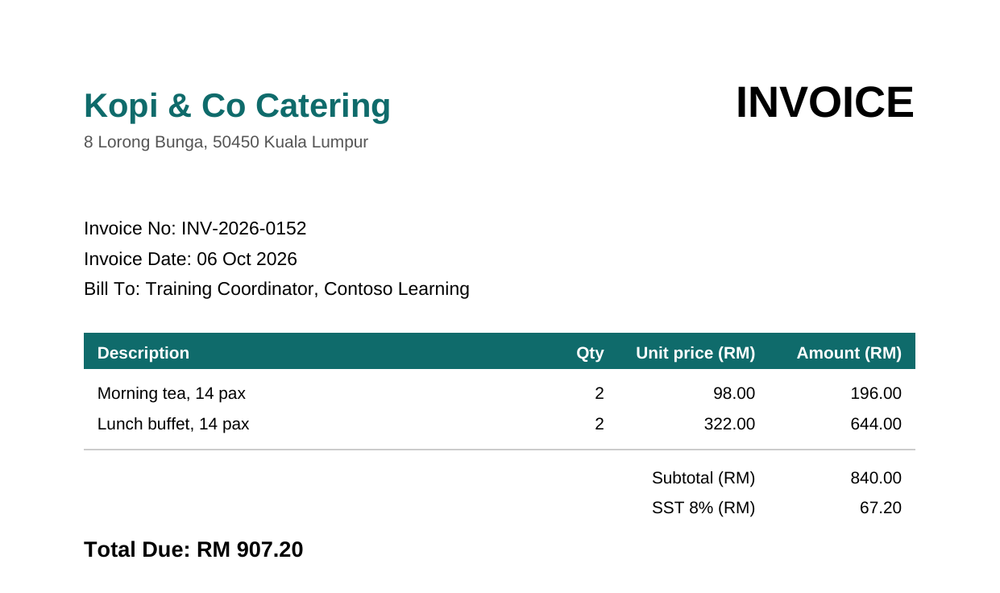

# 12 - Read PDF Invoices into Excel

Supplier invoices for your training sessions arrive as PDFs: the venue, the caterer, the printer. Someone opens each one and types the invoice number, date and total into a spreadsheet. In this chapter a desktop flow does that typing for you. It works through a folder of PDFs, pulls the three values out of each one and adds a row to an Excel log.

> **Copy-paste values:** every value you need is in the steps, with a Copy button. The [copy-paste page](./copy-paste.md) has them all on one page too.

**Estimated time:** 50 minutes

**Your result:** A desktop flow that reads every PDF invoice in a folder and logs its file name, invoice number, date and total in Excel.

> **Download:** the files for this lab
>
> - [invoices.zip](https://asraf-js.github.io/Microsoft-Power-Automate/12-pdf-invoices/invoices.zip): five fictional supplier invoices in a folder called `Invoices`.
> - [InvoiceLog.xlsx](https://asraf-js.github.io/Microsoft-Power-Automate/12-pdf-invoices/InvoiceLog.xlsx): an empty log with four column headings.

---

## What You Will Learn

- List the files in a folder with **Get files in folder**
- Repeat steps for each file with **For each**
- Pull all the text out of a PDF with **Extract text from PDF**
- Find one value inside a block of text with **Parse text**
- Add a row under the last one with **Get first free column/row from Excel worksheet**
- Save and close Excel at the end of a flow

---

## How the Flow Works

**Get files in folder > Launch Excel > For each file (extract the text > find the invoice number, date and total > find the next empty row > write four cells) > End > Close Excel**

The flow gets a list of every PDF in the `Invoices` folder and opens the log in Excel. For each PDF it extracts the text, then uses Parse text three times to find the value after *Invoice No:*, *Invoice Date:* and *Total Due: RM*. It asks Excel for the first empty row and writes the four values there. When every file is done, it saves and closes the workbook.

Every invoice in the zip uses the same labels, like this one:



*The flow looks for the text straight after Invoice No:, Invoice Date: and Total Due: RM. Those three labels are what makes this work.*

> **Key point:** This kind of flow works when your invoices share a layout, which is common when they come from the same system or the same few suppliers. A supplier with different labels needs its own patterns.

---

## Before You Begin

You need:

- A Windows computer with **Power Automate for desktop**, signed in with your training account (as in Chapter 11).
- The **Excel desktop app**.
- `invoices.zip` downloaded, then extracted to your **Desktop**: right-click it, choose **Extract All**, and pick the Desktop. You should now have a `Invoices` folder on the Desktop with five PDFs inside.
- `InvoiceLog.xlsx` saved to your Desktop. Open it once to see the four headings in row 1 (**File**, **Invoice No**, **Invoice Date**, **Total (RM)**), then close it.

> **Warning:** Extract text from PDF reads PDFs that contain real text, like the ones in this lab. A scanned invoice is just a picture of text, so it returns nothing. Scanned documents need OCR or AI Builder, which this chapter doesn't cover.

---

## 12.1 Create the Desktop Flow

1. Open **Power Automate** (the desktop app) from the Start menu.
2. Select **+ New flow**, enter the name below, then select **Create**.

   ```text
   PA - Invoice log
   ```

As in Chapter 11, add each action by searching for it in the **Actions** pane, then double-clicking it or dragging it into **Main**. Fill in the settings window and select **Save**.

---

## 12.2 List the PDF Files

1. Search for `Get files in folder` and add it.
2. In **Folder**, select the folder icon at the right of the box, select **Desktop** and then the `Invoices` folder, and select **OK**.
3. In **File filter**, enter:

   ```text
   *.pdf
   ```

   The `*` means *any name*, so this picks up every PDF and nothing else.
4. Leave **Variables produced** as `Files`. It holds the list of PDFs.
5. Select **Save**.

---

## 12.3 Open the Log in Excel

1. Search for `Launch Excel` and add it below Get files in folder.
2. Set **Launch Excel** to **and open the following document**.
3. In **Document path**, select the file icon, browse to your Desktop and select `InvoiceLog.xlsx`.
4. Leave **Make instance visible** on and **Variables produced** as `ExcelInstance`.
5. Select **Save**.

---

## 12.4 Repeat for Each File

1. Search for `For each` and, under **Loops**, add **For each** below Launch Excel.
2. In **Value to iterate**, enter:

   ```text
   %Files%
   ```

3. Leave **Store into** as `CurrentItem`. On each pass it holds one PDF file.
4. Select **Save**. The designer adds a **For each** line and an **End** line. Every action from 12.5 to 12.8 goes between them, just above **End**.

> **Note:** In Chapter 11 you used **Loop**, which counts row numbers. **For each** goes through a list instead, one item at a time, so you don't need to know how many files there are.

---

## 12.5 Extract the Text

1. Search for `Extract text from PDF` and drag it between **For each** and **End**.
2. In **PDF file**, enter:

   ```text
   %CurrentItem%
   ```

3. Leave **Page(s) to extract** as **All**.
4. Leave **Variables produced** as `ExtractedPDFText`. It holds all the words on the invoice as one block of text.
5. Select **Save**.

---

## 12.6 Find the Three Values

You add **Parse text** three times, once for each value. Each one searches `ExtractedPDFText` with a pattern (a *regular expression*) and keeps what it finds.

**Invoice number**

1. Search for `Parse text` and add it below Extract text from PDF, inside the loop.
2. In **Text to parse**, enter:

   ```text
   %ExtractedPDFText%
   ```

3. In **Text to find**, paste:

   ```text
   (?<=Invoice No:\s*)\S+
   ```

4. Turn on **Is regular expression**.
5. Turn on **First occurrence only**.
6. Under **Variables produced**, rename `Match` to:

   ```text
   InvoiceNo
   ```

7. Select **Save**.

**Invoice date**

1. Add another **Parse text** below the first, with **Text to parse** `%ExtractedPDFText%`, **Is regular expression** on and **First occurrence only** on.
2. In **Text to find**, paste:

   ```text
   (?<=Invoice Date:\s*)\d{2} \w{3} \d{4}
   ```

3. Rename `Match` to:

   ```text
   InvoiceDate
   ```

4. Select **Save**.

**Total**

1. Add a third **Parse text** with the same settings.
2. In **Text to find**, paste:

   ```text
   (?<=Total Due:\s*RM\s*)[\d,.]+
   ```

3. Rename `Match` to:

   ```text
   InvoiceTotal
   ```

4. Select **Save**.

You don't need to write patterns like these from scratch, but it helps to read them:

| Part | Means |
|------|-------|
| `(?<=Invoice No:\s*)` | Start right after the words *Invoice No:* and any spaces. The label itself isn't kept |
| `\S+` | Keep everything up to the next space: `INV-2026-0152` |
| `\d{2} \w{3} \d{4}` | Two digits, a space, three letters, a space, four digits: `06 Oct 2026` |
| `[\d,.]+` | Digits, commas and dots only: `907.20` or `1,144.80` |

> **Tip:** For a different supplier, change only the label inside `(?<=` and `\s*)` to match their invoice, for example `Bill No:` instead of `Invoice No:`.

---

## 12.7 Find the Next Empty Row

1. Search for `Get first free column/row from Excel worksheet` and add it below the third Parse text, inside the loop.
2. **Excel instance** shows `%ExcelInstance%`. Leave it.
3. Select **Save**. It produces `FirstFreeColumn` and `FirstFreeRow`. You only need `FirstFreeRow`: row 2 for the first invoice, then 3, and so on.

This sits inside the loop on purpose. After each invoice is written, the next empty row moves down by one.

---

## 12.8 Write the Four Cells

Add **Write to Excel worksheet** four times, inside the loop, one below the other. For each one, set **Write mode** to **On specified cell**, **Row** to `%FirstFreeRow%`, and the value and column below:

| # | Value to write | Column |
|---|----------------|--------|
| 1 | `%CurrentItem.Name%` | `1` |
| 2 | `%InvoiceNo%` | `2` |
| 3 | `%InvoiceDate%` | `3` |
| 4 | `%InvoiceTotal%` | `4` |

1. Search for `Write to Excel worksheet` and add it below Get first free column/row.
2. In **Value to write**, enter:

   ```text
   %CurrentItem.Name%
   ```

   `CurrentItem` is the whole file. `.Name` is just its file name, such as `Kopi-0152.pdf`.
3. Set **Write mode** to **On specified cell**. In **Column**, enter `1`. In **Row**, enter:

   ```text
   %FirstFreeRow%
   ```

4. Select **Save**.
5. Add the second, third and fourth **Write to Excel worksheet** the same way, using the values and columns from the table above:

   ```text
   %InvoiceNo%
   ```

   ```text
   %InvoiceDate%
   ```

   ```text
   %InvoiceTotal%
   ```

> **Tip:** Right-click the first Write action and select **Copy**, then right-click it again and **Paste** three times. Then you only change the value and column in each copy.

---

## 12.9 Save and Close Excel

This action goes **after End**, outside the loop, so it runs once when every invoice is done.

1. Search for `Close Excel` and drag it below **End**. It should not be indented.
2. **Excel instance** shows `%ExcelInstance%`.
3. Set **Before closing Excel** to **Save document**.
4. Select **Save**.

---

## 12.10 Check Your Finished Flow

Select **Save** (the disk icon). The status bar should show **14 Actions**, in this order:

| # | Action | What it does |
|---|--------|--------------|
| 1 | Get files in folder | Lists every PDF in `Invoices` into `Files` |
| 2 | Launch Excel | Opens InvoiceLog.xlsx into `ExcelInstance` |
| 3 | For each | Repeats for each file, holding it in `CurrentItem` |
| 4 | Extract text from PDF | All the invoice text into `ExtractedPDFText` |
| 5 | Parse text | The invoice number into `InvoiceNo` |
| 6 | Parse text | The date into `InvoiceDate` |
| 7 | Parse text | The total into `InvoiceTotal` |
| 8 | Get first free column/row from Excel worksheet | The next empty row into `FirstFreeRow` |
| 9 | Write to Excel worksheet | File name to column 1 |
| 10 | Write to Excel worksheet | Invoice number to column 2 |
| 11 | Write to Excel worksheet | Date to column 3 |
| 12 | Write to Excel worksheet | Total to column 4 |
| 13 | End | Back to For each for the next file |
| 14 | Close Excel | Saves the log and closes Excel |

Actions 4 to 12 should be indented under **For each**. **Close Excel** should line up with **For each**, not with the actions inside it.

---

## 12.11 Run and Check

1. Make sure `InvoiceLog.xlsx` is closed.
2. Select **Run** (the play icon). Excel opens and five rows appear, one by one. Then Excel closes.
3. Open `InvoiceLog.xlsx` from your Desktop. It should look like this, although the order of the rows can differ:

| File | Invoice No | Invoice Date | Total (RM) |
|------|------------|--------------|------------|
| Bright-0141.pdf | INV-2026-0141 | 03 Oct 2026 | 1,144.80 |
| Fabrikam-0185.pdf | INV-2026-0185 | 16 Oct 2026 | 1,360.80 |
| Kopi-0152.pdf | INV-2026-0152 | 06 Oct 2026 | 907.20 |
| Northwind-0174.pdf | INV-2026-0174 | 13 Oct 2026 | 239.54 |
| PrintRight-0163.pdf | INV-2026-0163 | 09 Oct 2026 | 325.08 |

Excel may show the dates and totals in its own format, for example `3/10/2026` or `1144.8`. That's Excel recognising them as a date and a number, which is what you want.

> **Tip:** To see what a variable held, look at the **Variables** pane on the right after a run. It shows the values from the last invoice. Double-click `ExtractedPDFText` to read the full text the flow worked with.

---

## Independent Practice

Run the flow a second time without changing anything, then open the log. What happened, and why? Think about what a real invoice process should do with a PDF once it's been logged. The Going further box has one answer.

---

> **Going further: move each invoice once it's logged.** Create a `Processed` folder inside `Invoices`. Inside the loop, after the last Write action, add **Move file(s)** with **File(s) to move** `%CurrentItem%` and **Destination folder** the `Processed` folder. Now a second run only picks up new invoices. To test again, move the PDFs back. Optional.

---

## Troubleshooting

| Symptom | What to check |
|---------|---------------|
| Nothing happens and no rows appear | **Folder** in Get files in folder must be the `Invoices` folder itself, and **File filter** must be `*.pdf` |
| A cell is empty | The matching Parse text found nothing. Check **Is regular expression** is on and the pattern was pasted exactly, including the brackets |
| Every row has the same values | **Text to parse** must be `%ExtractedPDFText%` in all three Parse text actions, and Extract text must use `%CurrentItem%` |
| All rows overwrite row 2 | Get first free column/row must be inside the loop, and every Write must use `%FirstFreeRow%` |
| *Excel instance is not valid* | Close Excel is inside the loop. Drag it below **End** |
| *The file is in use* | InvoiceLog.xlsx was open when you selected Run. Close it and run again |
| The column shows the full path | Use `%CurrentItem.Name%`, not `%CurrentItem%`, in the first Write |

---

## Lesson Summary

A desktop flow listed the PDFs in a folder, read the text out of each one and used three short patterns to pick out the values a person would have retyped. Get first free column/row kept adding rows under the last one, and Close Excel saved the log once at the end. Point it at a folder of real invoices with matching labels and it does the same job.

For reference, see the [PDF actions reference](https://learn.microsoft.com/en-us/power-automate/desktop-flows/actions-reference/pdf), the [text actions reference](https://learn.microsoft.com/en-us/power-automate/desktop-flows/actions-reference/text) and the [Excel actions reference](https://learn.microsoft.com/en-us/power-automate/desktop-flows/actions-reference/excel).
